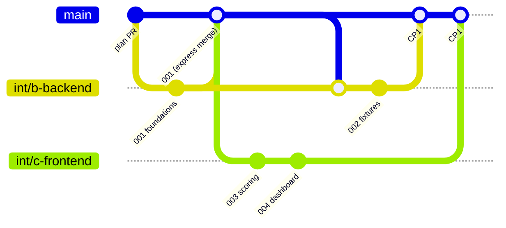

# CareThread: Team workflow (4 people, 4 laptops, one GitHub repo)

Read this once before you touch code. It is short on purpose.

## The 6 rules

1. **Nobody pushes to `main`. Ever.** GitHub branch protection requires an approved PR and applies
   to admins. `main` changes only through a pull request merged on GitHub.
   The optional local hook is a reminder, not a substitute for server-side protection.
2. **You work on your own integration branch** `int/<role>` (table below). Your AI workers build each
   ticket on `ticket/NNN-slug` and merge it into your `int/<role>` branch only after its `eval.md` passes.
3. **At each checkpoint you open one PR `int/<role> -> main`.** The merge captain merges green PRs with
   **"Create a merge commit"** (configure the repository to keep this option enabled).
4. **Right after each checkpoint everybody merges `origin/main` into their branch** and runs
   `npm install` and `npm run db:migrate`.
5. **Never rebase, force-push or cherry-pick** a branch that is on GitHub. Merge instead.
6. **Every laptop runs its own Supabase in Docker.** No shared database, no cloud project today.
   `.env.local` is never committed.

## People, branches, tickets

Write your name in the first column (same roles as the team plan section 4).

| Name | Role | Integration branch | Builds tickets | Dev ports |
|------|------|--------------------|----------------|-----------|
| ______ | A. Voice | `int/a-voice` | 005, 009, 010, 011, 015 | 3000 + workers 3001-3003 |
| ______ | B. AI and backend | `int/b-backend` | 001, 002, 006, 012, 013 | 3000 + workers 3001-3003 |
| ______ | C. Frontend | `int/c-frontend` | 003, 004, 007, 008 | 3000 + workers 3001-3003 |
| ______ | D. Founder and pitch | `int/d-pitch` | 014 (+ role-play audio, validation, deck) | 3000 + worker 3001 |

GitHub collaborators: `vishnumarthala`, `manjuchavva135`, `NithinReddyChalla6`,
`vigneshwarreddymarthala-dotcom`.

**Merge captain:** `vishnumarthala` (repo admin). Backup: whoever the captain names in the team chat.
The captain merges PRs, smoke-tests `main` after each checkpoint and tags it.

Ticket details and dependencies: [specs/tickets/BOARD.md](../specs/tickets/BOARD.md).

## Branch model

- `main` - protected; only checkpoint PR merges.
- `int/<role>` - your integration branch, pushed to GitHub, contains only tickets whose eval passed.
- `ticket/NNN-slug` - one per ticket, created by the super-agent worker (or by you), local only. You can
  push it for backup, but PRs go from `int/<role>`.
- `fix/<slug>` - bug fixes after the 15:30 freeze, PR straight to `main`, merged at CP5.

## One-time laptop setup (do it now, ~15 min)

1. After the plan PR is merged, install and start **Docker Desktop**. Node 20+, git, and on Windows use **Git Bash** for every command.
2. `git clone https://github.com/vishnumarthala/Hackathon-team-indofachkraft.git && cd Hackathon-team-indofachkraft`
3. `git config core.hooksPath .githooks` (turns on the "no push to main" hook; `npm install` also does it after ticket 001)
4. Allow time for the first Supabase Docker image download after ticket 001 is merged.
5. Create your branch from the latest main: `git fetch origin && git switch -c int/<role> origin/main && git push -u origin int/<role>`
6. After 001 is on main (you merged `origin/main`):
   - `npm install`
   - `npx supabase start` (prints local URLs; Studio at http://127.0.0.1:54323)
   - `npm run db:env` (writes the local Supabase URL/keys/DB URL into `.env.local`, creating it from `.env.example`)
   - add your API keys to `.env.local` (`GEMINI_API_KEY`, `ELEVENLABS_*`, `RESEND_API_KEY`), keep `DEMO_MODE=true` while building
   - `npm run db:migrate` then `npm run seed:demo` (after 002) and `npm run dev -- -p 3000`

Run `npx supabase start` only in your main checkout. Worker worktrees on the same laptop reuse the
same Docker stack through the copied `.env.local`.

## How you build a ticket

**With the super-agent:** use its planning and review output, and only start a worker once its ticket
requirements and evaluation are complete. Give the worker your checked-out `int/<role>` as its base,
the ticket, a distinct port and a run prefix. Have the worker create a separate worktree and report
its test and review evidence. Only work on tickets assigned to you.

Do **not** run the router's automatic merger. Its instructions check out the configured main branch
and include a destructive `git reset --hard` recovery path; they have not been adapted or tested for
this team workflow. In particular, do not set `Main branch: HEAD`: `git checkout HEAD` detaches HEAD.
The builder integrates passing worker branches manually as below. The router/merger can be re-enabled
only after its integration-branch targeting and safe recovery have been changed and tested.

**By hand (Cursor or plain Claude Code):** `git switch -c ticket/NNN-slug int/<role>`, build exactly
what `rd.md` says, run every check in `eval.md`, then
`git switch int/<role> && git merge --no-ff ticket/NNN-slug` and set the ticket's status to `done` in its
`rd.md` and in your table of `BOARD.md`.

Push `int/<role>` whenever a ticket lands in it (`git push`), so teammates can use it.

## Need a teammate's ticket before the next checkpoint?

Merge their pushed integration branch into yours:
`git fetch origin && git merge origin/int/<their-role>`. It only contains tickets that passed their
eval. Never copy files by hand, never cherry-pick.

## Checkpoints (merge windows)

| Time | Checkpoint | Goal on `main` after it |
|------|------------|-------------------------|
| Target 12:45 | CP0 | Reconcile and review the plan PR, then merge it. B starts 001 after it is ready. |
| Target ~13:15 | 001 express | Merge 001 as soon as it is green - the only merge outside a checkpoint (everything waits for it). |
| 13:30 | CP1 | 002 fixtures, 003 scoring, 004 dashboard, 014 landing |
| 14:15 | CP2 | 005 transcription, 006 extraction, 007 review screen, 009 intake link |
| 15:00 | CP3 | 008 upload panel = **Phase 2 end to end**, 010 brief, 011 report, 012 referral |
| 15:30 | CP4 = feature freeze | 013 ask the case, 015 voice note (only if green). After this: `fix/*` PRs only. |
| 16:15 | CP5 = final | Bug fixes merged, `main` tagged `demo`, demo recorded from that tag |

If Phase 2 is not end to end on `main` at CP3, D cuts scope (013, 015 first) and everyone helps.

**Before the checkpoint (T-10 min), every person:**

1. `git fetch origin && git merge origin/main` (resolve conflicts if any - see below)
2. After ticket 001 is available: `npm install && npm run db:migrate`
3. After ticket 001 is available: `npm run verify` (lint + typecheck + unit tests + build) must pass.
   Before 001, review the planning documents manually instead.
4. `git push`
5. Open the PR on GitHub, or use
   `gh pr create --base main --head int/<role> --title "CP<n>: <role> - tickets 00x, 00y"` and fill
   in the PR template in the editor. Do not use `--fill`, which replaces the template with commit
   text. For the planning PR and other pre-001 PRs, mark app/CI checks not applicable with a reason.
   If nothing new passed since the last checkpoint, skip the PR.

**At the checkpoint, the merge captain:**

1. Merges in dependency order: B, C, A, D. After ticket 001 adds CI, its `ci` check must be green.
   Button: **Create a merge commit**.
2. If a PR conflicts after an earlier merge, the PR's author runs step 1 again and pushes (2 minutes).
3. On the captain's laptop: `git switch main && git pull` (read-only use of main), `npm install`,
   `npx supabase db reset`, `npm run seed:demo`, `npm run dev -- -p 3000`, click through the demo path,
   then `git tag cp<n> && git push origin cp<n>`. Posts "CP<n> merged" in the team chat.

**After the checkpoint, every person:** `git fetch origin && git merge origin/main`, `npm install`,
`npm run db:migrate`, continue. Switch back to your `int/<role>` if you looked at `main`.

## Avoiding merge conflicts

- A ticket only changes the files in its rd.md "Affected areas". Those lists were written so that two
  builders never own the same file.
- `lib/types.ts`, `.env.example`, `package.json` scripts and `supabase/migrations/*_init.sql` belong to
  ticket 001. Later tickets add their own modules instead of editing them.
- New database change = **new** migration file `supabase/migrations/<YYYYMMDDHHMMSS>_<name>.sql`
  (additive only: new tables/columns). Never edit a migration that is on `main`.
- New npm dependency: say it in the team chat. On a `package-lock.json` conflict take `main`'s version
  (`git checkout --theirs package-lock.json` while merging main) and run `npm install`.
- `BOARD.md` has one table per builder. Only change rows in your own table.
- `docs/system-design.md` is the contract. Changing a shape there needs a message in the team chat and
  the owner of every affected ticket agreeing.

## Local-only setup: what changes

- **Database and storage:** Supabase CLI in Docker (`npx supabase start`): API http://127.0.0.1:54321,
  Postgres 127.0.0.1:54322, Studio http://127.0.0.1:54323. Audio files go to the local Storage bucket
  `recordings`. `npx supabase db reset` wipes and rebuilds your local DB from the migrations.
- **ElevenLabs post-call webhook can't reach localhost.** After the browser call ends, the intake page
  calls `POST /api/intake/:token/complete`, which fetches the finished conversation from ElevenLabs
  (`GET /v1/convai/conversations/:id`). The webhook route still exists for later (deployed or tunnel).
- **Microphone needs a secure page.** Do the parent intake call in a browser on the same laptop
  (`http://localhost:3000/intake/...` counts as secure). A phone needs an HTTPS tunnel - optional.
- **Product link for the submission** (checklist says "works in an incognito window"): D decides at
  15:30 between deploying (Vercel + a Supabase cloud project: `npx supabase link` + `npx supabase db push`,
  env vars only) or a tunnel during judging. The code needs no change for either.
- `DEMO_MODE=true` (default in `.env.example`) answers Scribe, Gemini, ElevenLabs and Resend from
  `demo/fixtures/`, so you can build and test without spending credits. Turn it off to test live.

## GitHub Free: protection for `main`

This repository is **public**, and GitHub Free for personal accounts supports unlimited collaborators
and protected branches on public repositories. Standard GitHub-hosted Actions runners are free for
public repositories; do not assume the same features or billing if the repository becomes private.
See [GitHub's plans](https://docs.github.com/en/get-started/learning-about-github/githubs-plans)
and [protected branches](https://docs.github.com/en/repositories/configuring-branches-and-merges-in-your-repository/managing-protected-branches/about-protected-branches).

**Current state:** the GitHub API confirmed on November 7 that `main` requires a pull request with
one approval, dismisses stale approvals and enforces the rule for administrators. Force pushes and
branch deletion are disabled. Merge commits are enabled, squash and rebase merging are disabled, and
merged branches are not automatically deleted. No status check is required yet because CI does not
exist. The optional local hook remains bypassable.

To inspect or recreate the protection if settings change:

1. Repository admin: GitHub **Settings > Branches**; check the protection rule for `main`.
2. Select **Require a pull request before merging**, require at least one approval, and select
   **Do not allow bypassing the above settings** so administrators are included, and dismiss stale
   approvals. Keep force pushes and branch deletion disabled. Administrators can still change or
   remove the rule, so this prevents ordinary bypass, not deliberate rule changes by an admin.
3. In **Settings > General > Pull Requests**, enable merge commits. For this long-lived-branch
   workflow, disable squash and rebase merging and automatic deletion of head branches.
4. Verify the saved rule at Settings > Branches or with
   `gh api repos/vishnumarthala/Hackathon-team-indofachkraft/branches/main/protection`.
   Check pull requests, approval count, admin enforcement, force-push and deletion settings in the
   response. Do not attempt a real direct push as a test: it could update `main` if protection failed.
5. After 001 creates the Actions workflow and `ci` has appeared from a successful PR run, edit the
   protection rule and require that exact status check. Until then, the team verifies manually;
   after configuration verify a subsequent PR is blocked until the check succeeds.

Every laptop can additionally enable `.githooks/pre-push` with `git config core.hooksPath .githooks`
after the plan PR is available. Hooks are local, opt-in and bypassable, and do not protect GitHub's
web/API paths. The captain and another collaborator must review and merge PRs on GitHub; merging a PR
is allowed, but direct pushes to `main` are not. If protection settings are unavailable or verification
fails, stop checkpoint merging and tell the team rather than claim `main` is protected.

The repo is public: never commit API keys, real patient data, recordings or private logs. Use synthetic
demo data and keep local Supabase data and `.env.local` off GitHub.

Before opening or updating a plan PR, merge the latest `origin/main` into the planning branch, review
the resulting diff and resolve conflicts without discarding teammate work; do not force-push.

## Cheat sheet

| I want to... | Command |
|--------------|---------|
| start my day / after a checkpoint | `git fetch origin && git merge origin/main && npm install && npm run db:migrate` |
| start the local database | `npx supabase start` |
| reset local data | `npx supabase db reset && npm run seed:demo` |
| run the app | `npm run dev -- -p 3000` |
| check before a PR | `npm run verify` |
| share my finished tickets | `git push` (on `int/<role>`) |
| get a teammate's finished tickets early | `git merge origin/int/<their-role>` |
| open my checkpoint PR | `gh pr create --base main --head int/<role>` (complete the template) |
| see the board | `specs/tickets/BOARD.md` or `/super-agent:mark-ready` |
